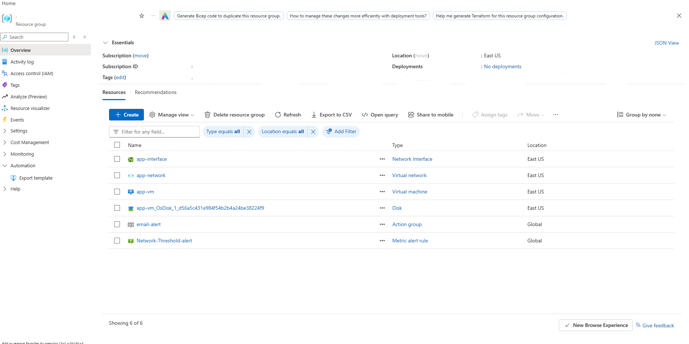
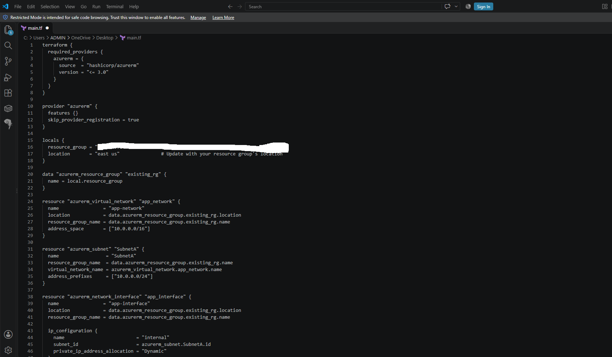
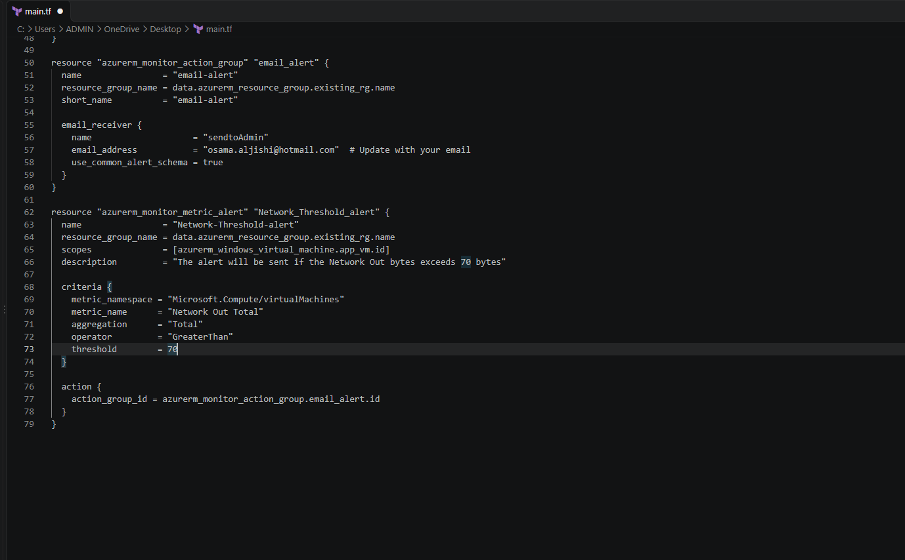
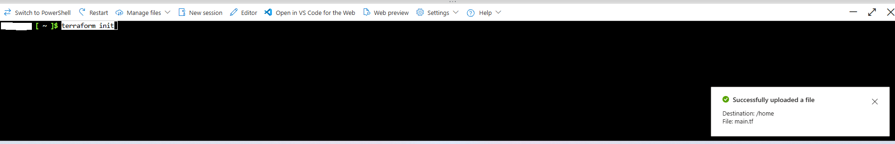
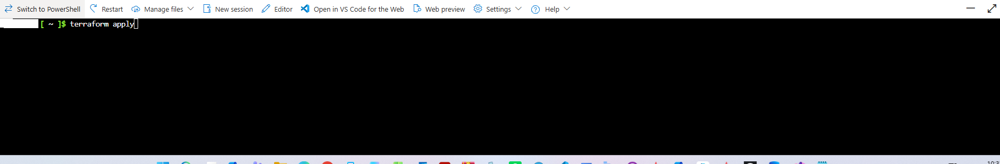

# Azure Windows VM Infrastructure Provisioning with Azure Monitor Alerts using Terraform

---

## 1. Architecture & Provisioned Resources

### Core Infrastructure Topology

| Resource Type | Resource Name | Specification / Purpose | Region / Location |
| :--- | :--- | :--- | :--- |
| **Virtual Network** | `app-network` | Virtual network with `10.0.0.0/16` address space | East US |
| **Subnet** | `SubnetA` | Workload subnet with `10.0.0.0/24` address prefix | East US |
| **Network Interface** | `app-interface` | Primary network interface with dynamic IP allocation | East US |
| **Windows Virtual Machine** | `app-vm` | `Standard_B2s` VM running Windows Server 2019 Datacenter | East US |
| **Action Group** | `email-alert` | Azure Monitor Action Group configured for administrator email notifications | Global |
| **Metric Alert Rule** | `Network-Threshold-alert` | Azure Monitor metric alert triggering when Network Out Total exceeds 70 bytes | Global |

---

### Provisioned Environment Validation

*Resource group inventory confirming successful deployment of Virtual Network, Subnet, Network Interface, Windows VM, Action Group, and Metric Alert Rule.*

---

## 2. Step-by-Step Implementation

### Step 1: Write Main Infrastructure Configuration

1. Defined Terraform provider configuration using HashiCorp `azurerm` provider.
2. Configured networking resources including Virtual Network `app-network`, Subnet `SubnetA`, and Network Interface `app-interface`.

*VS Code editor demonstrating Terraform HCL block defining Azure provider, local variables, virtual network, and network interface resources.*

---

### Step 2: Define Compute and Azure Monitor Alert Resources

1. Configured `azurerm_windows_virtual_machine` resource for `app-vm` with attached OS disk and source image reference.
2. Created `azurerm_monitor_action_group` for email notifications and `azurerm_monitor_metric_alert` for monitoring VM network egress bytes.

*VS Code editor displaying HCL configuration for action group receivers and metric alert rule criteria targeting the virtual machine.*

---

### Step 3: Initialize Terraform Working Directory

1. Uploaded `main.tf` configuration file to the working directory.
2. Executed `terraform init` to download required provider plugins and initialize backend settings.

*Terminal prompt displaying file upload confirmation and execution of terraform init command.*

---

### Step 4: Apply Terraform Configuration

1. Executed `terraform apply` to create and provision all defined Azure resources.
2. Verified automated provisioning of network components, virtual machine, and metric alert rules.

*Terminal command prompt confirming execution of terraform apply to provision cloud resources.*

---

## 3. Verification & Monitoring

### Endpoint Validation

1. Navigated to the Azure Portal to confirm resource creation under the specified resource group.
2. Verified active status of the `Network-Threshold-alert` metric alert rule connected to the `email-alert` action group.

*Azure Portal resource group overview confirming active deployment and binding of metric alert rules to the virtual machine.*
